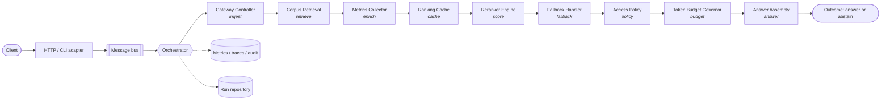

# Data flow

1. Upstream Retriever sends [Query, List[Candidates]] to Gateway Controller.
2. Gateway Controller forwards payload to Reranker Engine.
3. Reranker Engine computes scores using cross-attention mechanism.
4. Engine sorts candidates by score descending.
5. Gateway Controller returns reordered list.
6. On failure, Fallback Handler returns original order with a warning flag.

The `PipelineContext` is the only mutable object in a run. Stages read the request,
mutate candidates, and append decisions. Nothing else carries run state.
