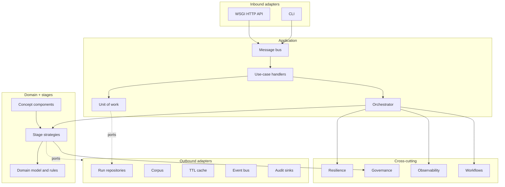

# Architecture overview

Reorder candidates using stronger relevance judgments.

## Goals

1. Correctness first: an answer is released only with evidence the caller is entitled to see.
2. Explainability: every inclusion, exclusion, and degradation is recorded as a decision.
3. Graceful degradation: optional stages may fail without taking the service down.
4. Replaceability: every external dependency sits behind a port.

## Style

**Componentized Pipeline with Fallback**, realised as hexagonal architecture with a strategy-based stage pipeline.

## Stage pipeline

1. `gateway_controller` (ingest): Validates, normalises, de-duplicates, and bounds the incoming candidate set.
2. `corpus_retrieval` (retrieve): Pulls candidates from the corpus when the caller did not supply any.
3. `metrics_collector` (enrich): Annotates candidates with structural features and collapses exact duplicates.
4. `ranking_cache` (cache): Reuses a prior ranking for an identical tenant, principal, query, and candidate set.
5. `reranker_engine` (score): Blends upstream prior scores with query-aware relevance and reorders candidates.
6. `fallback_handler` (fallback): Restores a safe prior-score ordering when an upstream stage degraded.
7. `access_policy` (policy): Fail-closed tenant, clearance, and ACL filtering plus PII redaction.
8. `token_budget_governor` (budget): Keeps the highest-ranked candidates that fit inside the token budget.
9. `answer_assembly` (answer): Assembles a citation-backed answer, or abstains when evidence is insufficient.

## Key modules

| Module | Responsibility |
|---|---|
| `application/orchestrator.py` | Executes stages with breakers, retries, deadlines, spans, checkpoints |
| `stage_catalog.py` | Default topology and registry wiring |
| `container.py` | Composition root |
| `governance/policy_engine.py` | Deny-overrides access decisions |
| `workflows/state_machine.py` | Legal run lifecycle transitions |
